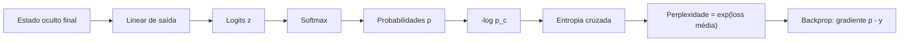

# Softmax, logits e entropia cruzada

## Visão geral


Nesta página, vamos construir a intuição do zero, resolver exemplos numéricos completos à mão, apresentar o código em PyTorch e, ao final, mostrar por que a entropia cruzada aparece em cada passo de treinamento de um modelo de linguagem e como a perplexidade se deriva dela.

## Intuição: de pontuação a probabilidade

### O que é um logit?

Ao final do corpo do transformer, uma camada linear projeta o estado oculto para um vetor do tamanho do vocabulário. Cada componente desse vetor é um **logit**, uma pontuação crua (não normalizada) que indica o quão plausível é cada token como próxima palavra. Logits podem ser positivos, negativos ou zero, e não somam 1.

Suponha um vocabulário minúsculo com três tokens: `["gato", "cachorro", "peixe"]`. Uma rede pode produzir:

$$
z = [2.0,\; 1.0,\; 0.1]
$$

O token "gato" tem a maior pontuação, mas o que significa exatamente $2.0$? Nada em termos de probabilidade ainda. Precisamos de uma regra para converter essas pontuações em probabilidades válidas.

### Por que não normalizar direto?

Uma tentativa ingênua seria dividir cada logit pela soma:

$$
p_i = \frac{z_i}{\sum_j z_j}
$$

Isso falha por dois motivos: (1) logits negativos gerariam "probabilidades negativas"; (2) a escala é linear, enquanto a confiança relativa entre opções se comporta de forma exponencial (a diferença entre $5.0$ e $6.0$ deve importar mais que a diferença entre $0.1$ e $1.1$). O softmax resolve ambos.

## Softmax

### Definição

O softmax converte um vetor de logits $z \in \mathbb{R}^{K}$ em um vetor de probabilidades $p \in [0,1]^K$ que somam 1:

$$
p_i = \frac{\exp(z_i)}{\sum_{j=1}^{K} \exp(z_j)}
$$

A exponencial $\exp(z_i) = e^{z_i}$ garante que todos os termos sejam positivos, e a divisão pela soma normaliza o resultado.

### Exemplo numérico completo

Vamos resolver o softmax de $z = [2.0, 1.0, 0.1]$ passo a passo.

**Passo 1 — exponenciais.** Lembre que $e \approx 2.71828$.

- $\exp(2.0) = e^{2.0} \approx 7.3891$
- $\exp(1.0) = e^{1.0} \approx 2.7183$
- $\exp(0.1) = e^{0.1} \approx 1.1052$

**Passo 2 — soma.**

$$
\sum_{j=1}^{3} \exp(z_j) \approx 7.3891 + 2.7183 + 1.1052 = 11.2126
$$

**Passo 3 — divisão.**

$$
p_1 = \frac{7.3891}{11.2126} \approx 0.6590
$$

$$
p_2 = \frac{2.7183}{11.2126} \approx 0.2424
$$

$$
p_3 = \frac{1.1052}{11.2126} \approx 0.0986
$$

**Verificação.** A soma deve dar 1:

$$
0.6590 + 0.2424 + 0.0986 = 1.0000
$$

O modelo atribui $65.9\%$ de probabilidade a "gato", $24.2\%$ a "cachorro" e $9.9\%$ a "peixe".

### Propriedades importantes

1. **Invariância a translação**: somar uma constante $c$ a todos os logits não muda o softmax:

$$
\frac{\exp(z_i + c)}{\sum_j \exp(z_j + c)} = \frac{e^c \exp(z_i)}{e^c \sum_j \exp(z_j)} = \frac{\exp(z_i)}{\sum_j \exp(z_j)}
$$

2. **Confiança controlada pela diferença**: se os logits são todos iguais, $p_i = \frac{1}{K}$ (distribuição uniforme). Se um logit domina fortemente, a probabilidade se aproxima de 1.

3. **Sensibilidade à escala**: multiplicar os logits por um fator $T$ (temperatura) controla a "agudeza" da distribuição. Com $T \to 0$, o softmax tende ao argmax (one-hot); com $T \to \infty$, tende à distribuição uniforme:

$$
p_i = \frac{\exp(z_i / T)}{\sum_j \exp(z_j / T)}
$$

### O problema do overflow: log-sum-exp

Se um logit for grande (por exemplo, $z_i = 1000$), então $\exp(1000)$ estoura o `float32` (que aguenta até $\approx 3.4 \times 10^{38}$). A solução é subtrair o máximo antes de exponenciar, usando a propriedade de invariância à translação:

$$
p_i = \frac{\exp(z_i - m)}{\sum_j \exp(z_j - m)}, \quad m = \max_k z_k
$$

Essa é a técnica do **log-sum-exp**, que define:

$$
\text{LSE}(z) = \log\left(\sum_{j=1}^{K} \exp(z_j)\right) = m + \log\left(\sum_{j=1}^{K} \exp(z_j - m)\right)
$$

O log-sum-exp é numericamente estável e reaparece na implementação eficiente da entropia cruzada.

## Entropia

Antes da entropia cruzada, precisamos da entropia. A entropia de Shannon mede a incerteza de uma distribuição de probabilidade:

$$
H(p) = -\sum_{i=1}^{K} p_i \log p_i
$$

Para uma distribuição uniforme com $K$ itens, $H(p) = \log K$. Para uma distribuição one-hot (certeza total), $H(p) = 0$.

### Exemplo numérico

Com $p = [0.6590, 0.2424, 0.0986]$ (usando log natural):

$$
H(p) \approx -[0.6590 \log(0.6590) + 0.2424 \log(0.2424) + 0.0986 \log(0.0986)]
$$

$$
\log(0.6590) \approx -0.4170, \quad \log(0.2424) \approx -1.4171, \quad \log(0.0986) \approx -2.3167
$$

$$
H(p) \approx -[0.6590 \cdot (-0.4170) + 0.2424 \cdot (-1.4171) + 0.0986 \cdot (-2.3167)]
$$

$$
H(p) \approx -[-0.2748 - 0.3435 - 0.2284] = -[-0.8467] = 0.8467
$$

A incerteza dessa distribuição é $\approx 0.847$ nats (usando log natural; em bits, divida por $\log 2$).

## Entropia cruzada

### Definição

A entropia cruzada entre a distribuição verdadeira $y$ (one-hot, no caso de classificação) e a distribuição prevista $p$ é:

$$
H(y, p) = -\sum_{i=1}^{K} y_i \log p_i
$$

Quando $y$ é one-hot (somente a classe correta tem $y_c = 1$ e as demais $y_i = 0$), a soma colapsa para um único termo:

$$
H(y, p) = -\log p_c
$$

onde $c$ é o índice da classe correta. Ou seja, a perda vira simplesmente o negativo do logaritmo da probabilidade atribuída à resposta correta.

### Exemplo numérico resolvido

Suponha que o token correto seja "gato" (índice 0), então $y = [1, 0, 0]$, e a previsão foi $p = [0.6590, 0.2424, 0.0986]$:

$$
H(y, p) = -\log(0.6590) \approx 0.4170
$$

Compare três cenários para o mesmo logit correto:

| Probabilidade prevista para o correto | Entropia cruzada $-\log p_c$ |
|---|---|
| $0.9$ | $0.105$ |
| $0.6590$ | $0.417$ |
| $0.1$ | $2.303$ |
| $0.01$ | $4.605$ |

Quanto menor a probabilidade dada à classe correta, maior a perda. Se $p_c \to 0$, a perda tende a $+\infty$.

### Por que log e por que negativo?

- O **negativo** garante que a perda seja não negativa (o log de um número entre 0 e 1 é negativo).
- O **logaritmo** converte produtos em somas (facilita o cálculo e os gradientes) e penaliza fortemente erros graves: dar $p_c = 0.01$ custa muito mais que o dobro de dar $p_c = 0.1$.

## Por que a entropia cruzada é a loss padrão de LLM?

### Derivação pelo princípio da máxima verossimilhança

Treinar um LLM é, na prática, maximizar a probabilidade do corpus. Para uma sequência de $T$ tokens, a probabilidade do modelo é o produto:

$$
P(x_1, x_2, \dots, x_T) = \prod_{t=1}^{T} p(x_t \mid x_{<t})
$$

Produtos de muitos números entre 0 e 1 ficam numericamente minúsculos. Aplicamos o logaritmo (que transforma produto em soma) e o sinal negativo (para transformar maximização em minimização):

$$
\mathcal{L} = -\sum_{t=1}^{T} \log p(x_t \mid x_{<t})
$$

Essa soma é exatamente a entropia cruzada acumulada ao longo da sequência. Portanto, minimizar a entropia cruzada equivale a **maximizar a verossimilhança do texto**, que é o objetivo fundamental de um modelo de linguagem.

### Propriedades desejáveis para treino

- **Diferenciável**: o gradiente em relação aos logits é simples e bem comportado.
- **Convexa nos logits**: ajuda na convergência.
- **Gradiente informativo**: o gradiente do softmax + entropia cruzada é $p - y$, uma diferença elegante entre previsão e alvo (veremos abaixo).

### O gradiente mágico

Quando combinamos softmax e entropia cruzada, o gradiente em relação ao logit $z_i$ é:

$$
\frac{\partial \mathcal{L}}{\partial z_i} = p_i - y_i
$$

Esta é uma das fórmulas mais elegantes do deep learning: a derivada é simplesmente a diferença entre a probabilidade prevista e a distribuição alvo. Não há termos complicados da derivada do softmax, porque o log da exponencial cancela a exponencial.

### Verificação numérica do gradiente

Com $y = [1, 0, 0]$ e $p = [0.6590, 0.2424, 0.0986]$:

$$
\frac{\partial \mathcal{L}}{\partial z} = [0.6590 - 1, 0.2424 - 0, 0.0986 - 0] = [-0.3410, 0.2424, 0.0986]
$$

O gradiente negativo no logit da classe correta empurra a probabilidade para cima, enquanto os gradientes positivos nas demais empurram para baixo. Isso é exatamente o que o backpropagation precisa saber.

## Perplexidade

### Definição

A perplexidade é a exponencial da entropia cruzada média por token:

$$
\text{PPL} = \exp\left(-\frac{1}{T}\sum_{t=1}^{T} \log p(x_t \mid x_{<t})\right)
$$

Ela pode ser interpretada como "o número médio de opções igualmente prováveis entre as quais o modelo se sente indeciso". Uma perplexidade de $10$ significa que o modelo está, em média, tão confuso quanto se tivesse que escolher entre 10 alternativas equiprováveis.

### Exemplo numérico

Se a entropia cruzada média por token for $2.303$:

$$
\text{PPL} = \exp(2.303) \approx 10.0
$$

Se a média for $0.693$ (que é $\log 2$):

$$
\text{PPL} = \exp(0.693) \approx 2.0
$$

Quanto menor a perplexidade, melhor o modelo. Perplexidade $1$ seria o modelo perfeito (sempre prevê o token correto com probabilidade $1$).

### Relação com o log-sum-exp

Note que a entropia cruzada para o token correto pode ser reescrita usando o log-sum-exp dos logits:

$$
-\log p_c = -\log\left(\frac{\exp(z_c)}{\sum_j \exp(z_j)}\right) = -z_c + \log\left(\sum_j \exp(z_j)\right) = -z_c + \text{LSE}(z)
$$

Essa forma é a usada nas implementações eficientes, porque o log-sum-exp já é estável numericamente.

## Código em PyTorch

### Softmax e entropia cruzada na mão

```python
import torch
import torch.nn.functional as F

z = torch.tensor([2.0, 1.0, 0.1])          # logits

# softmax estável na mão
m = z.max()
logits_estaveis = z - m
exp = torch.exp(logits_estaveis)
p = exp / exp.sum()
print("probabilidades:", p)                 # [0.6590, 0.2424, 0.0986]

# usando a API
p2 = torch.softmax(z, dim=0)
print("softmax API:", p2)

# entropia cruzada: alvo one-hot, classe correta = 0
alvo = torch.tensor([0])                    # índice da classe correta
loss = F.cross_entropy(z.unsqueeze(0), alvo)
print("entropia cruzada:", loss.item())     # ~0.4170

# verificação manual
print("manual -log(p_c):", -torch.log(p[0]).item())
```

### O gradiente p - y

```python
z = torch.tensor([2.0, 1.0, 0.1], requires_grad=True)
loss = F.cross_entropy(z.unsqueeze(0), torch.tensor([0]))
loss.backward()
print("gradiente dL/dz:", z.grad)           # [-0.3410, 0.2424, 0.0986]
print("p - y:", p.detach() - torch.tensor([1.0, 0.0, 0.0]))
```

### Entropia cruzada em escala de lote

Em um LLM, a loss é calculada sobre um lote de sequências de shape `[batch, seq_len, vocab]`:

```python
batch, seq_len, vocab = 4, 32, 50257
logits = torch.randn(batch, seq_len, vocab)
alvos = torch.randint(0, vocab, (batch, seq_len))

# flatten para [batch*seq_len, vocab] e [batch*seq_len]
loss = F.cross_entropy(
    logits.reshape(-1, vocab),
    alvos.reshape(-1),
    ignore_index=-100,
)
print("loss média do lote:", loss.item())
```

O `ignore_index=-100` permite mascarar posições de padding, que não devem contribuir para a loss.

## Fluxo em diagrama



## Erros comuns

- **Usar logits direto como probabilidade**: logits não somam 1 e podem ser negativos. Sempre aplique softmax antes de interpretar como probabilidade.
- **Esquecer a estabilidade**: calcular `exp(z)` sem subtrair o máximo pode gerar `inf`/`NaN` em logits grandes.
- **Usar `softmax` seguido de `log` e depois `nll_loss`**: isso é redundante e numericamente instável. Use `cross_entropy` diretamente sobre os logits.
- **Confundir base do log**: entropia cruzada do PyTorch usa log natural (nats). Para bits, divida por $\log 2$.
- **Não mascarar padding**: posições de padding contribuem erroneamente para a loss se `ignore_index` não for usado.
- **Confundir perplexidade com acurácia**: perplexidade é sobre incerteza, não sobre acertos diretos. Um modelo pode ter acurácia alta e perplexidade ruim se errar de forma muito confiante.
- **Aplicar temperatura errado**: temperatura deve dividir os logits **antes** do softmax, e não ser aplicada às probabilidades.

## Resumo

- **Logits** são pontuações cruas, sem restrição de soma ou sinal.
- O **softmax** converte logits em probabilidades via $p_i = \frac{\exp(z_i)}{\sum_j \exp(z_j)}$, e é invariante a translações.
- O **log-sum-exp** estabiliza o softmax subtraindo o máximo antes de exponenciar.
- A **entropia cruzada** para um alvo one-hot reduz-se a $-\log p_c$, o negativo do log da probabilidade da classe correta.
- Minimizar a entropia cruzada equivale a maximizar a verossimilhança do texto, por isso é a loss padrão de LLMs.
- O gradiente do conjunto softmax + entropia cruzada é a fórmula elegante $\frac{\partial \mathcal{L}}{\partial z_i} = p_i - y_i$.
- A **perplexidade** é $\exp(\text{loss média})$ e mede a incerteza média do modelo.
