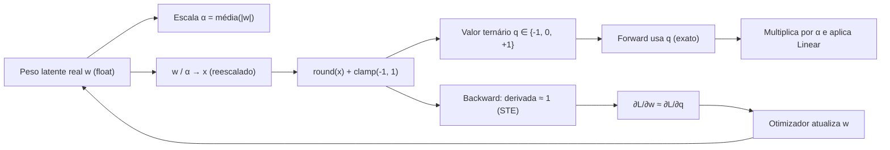

# Straight-Through Estimator (STE): como pesos ternários aprendem

> "A quantização é uma função não-diferenciável. O Straight-Through Estimator é a ponte que permite que o gradiente atravesse essa função sem que o treino pare."


---

## 1. Intuição: o que significa "aprender" quando o peso só vale três valores?

Uma rede neural aprende ajustando seus pesos na direção que reduz a função de perda $\mathcal{L}$. Esse ajuste é guiado pelo gradiente:

$$
\frac{\partial \mathcal{L}}{\partial w}
$$

que responde à pergunta: *"se eu aumentar um pouquinho o peso $w$, a perda sobe ou desce, e em que ritmo?"*. Para isso, o gradiente precisa "fluir" do valor previsto pelo modelo, atravessar todas as operações da rede, até chegar em $w$. Esse fluxo é a **retropropagação** (backpropagation).

O problema central aparece quando, no meio desse caminho, existe uma operação que **não é suave**: a quantização ternária. Ela transforma um número real qualquer em um de três valores possíveis:

$$
q(w) = \text{round}\left(\frac{w}{\alpha}\right),\quad \text{clamp para } [-1, 1]
$$

Como o arredondamento é uma função "escada", ela tem derivada igual a zero em quase todos os pontos. Em outras palavras:

> Se a função que transforma o peso em valor quantizado tem derivada zero, o gradiente da perda em relação ao peso também se anula — e o modelo para de aprender.

A intuição do STE é brutalmente simples e, ainda assim, funciona na prática: **no caminho para frente (forward), use o valor quantizado; no caminho para trás (backward), finja que a quantização era a função identidade**. Ou seja, "passe o gradiente direto" (straight-through) através da escada.

---

## 2. O conceito formal do STE

### 2.1 A quantização como porta de gradiente

Considere um peso latente real $w \in \mathbb{R}$ e uma função de quantização $q(\cdot)$ que produz valores ternários. Na etapa de forward, o modelo efetivamente usa:

$$
\tilde{w} = q(w)
$$

A perda $\mathcal{L}$ é, portanto, função de $\tilde{w}$, não de $w$ diretamente. Pela regra da cadeia:

$$
\frac{\partial \mathcal{L}}{\partial w} = \frac{\partial \mathcal{L}}{\partial \tilde{w}} \cdot \frac{\partial \tilde{w}}{\partial w}
$$

O termo problemático é $\frac{\partial \tilde{w}}{\partial w} = q'(w)$. Para uma função escada, $q'(w) = 0$ quase em toda parte (e é indefinida nos pontos de salto). O resultado é um gradiente nulo:

$$
\frac{\partial \mathcal{L}}{\partial w} = \frac{\partial \mathcal{L}}{\partial \tilde{w}} \cdot 0 = 0
$$

O peso não recebe nenhum sinal de correção, e o treino estagna.

### 2.2 A "aproximação" do STE

O Straight-Through Estimator substitui a derivada da quantização pela derivada da identidade, isto é, por $1$, na região em que o gradiente é bem definido:

$$
\frac{\partial \tilde{w}}{\partial w} \approx 1
$$

de modo que:

$$
\frac{\partial \mathcal{L}}{\partial w} \approx \frac{\partial \mathcal{L}}{\partial \tilde{w}}
$$

O gradiente é então **estimado** — não exatamente, mas bem o suficiente para que a otimização avance. Esse é o coração da técnica: forward exato (valor ternário), backward aproximado (como se nada tivesse acontecido).

### 2.3 A formulação de implementação mais comum

Na prática, em vez de guardar uma flag para o backward, usa-se um truque algébrico elegante. Define-se a "cópia do gradiente" com `detach`:

$$
\text{STE}(x) = (\text{quantize}(x) - x)\cdot \text{stop\_gradient} + x
$$

Em notação matemática, se $x = w / \alpha$ é o peso já reescalado pela escala $\alpha$:

$$
\tilde{x} = x + \big(\text{round}(x)\big|_{\text{clamp}} - x\big)_{\text{sem gradiente}}
$$

No forward, o valor numérico é exatamente $\text{round}(x)$ (clampado). No backward, o termo `detach` tem derivada zero, então:

$$
\frac{\partial \tilde{x}}{\partial x} = 1
$$


---

## 3. Diagrama de fluxo

O diagrama abaixo mostra o ciclo completo de um peso ternário dentro de uma camada `BitLinear`:



Perceba que o loop central mostra que o peso **latente** $w$ continua sendo um número real armazenado com ponto flutuante. Ele é quantizado apenas "na hora" de cada forward. O otimizador nunca vê o valor ternário — ele só vê o peso real e o gradiente estimado.

---

## 4. Matemática com exemplos numéricos resolvidos

### 4.1 Um peso só, passo a passo

Imagine uma camada com um único peso latente $w = 0.7$. Suponha, para simplificar, que a escala $\alpha$ seja fixa em $1.0$.

1. **Reescala**: $x = w / \alpha = 0.7 / 1.0 = 0.7$.
2. **Quantização**: $\text{round}(0.7) = 1$. Clamp em $[-1, 1]$ mantém $1$.
3. **Valor ternário efetivo**: $\tilde{w} = q = 1$.
4. **Forward**: a camada usa $1$ (não $0.7$).
5. **Backward**: a derivada da identidade é $1$, então o gradiente da perda em relação a $w$ é exatamente o gradiente que chegou até $\tilde{w}$.

Suponha que $\frac{\partial \mathcal{L}}{\partial \tilde{w}} = -0.3$ (a perda quer diminuir o valor efetivo do peso). Então:

$$
\frac{\partial \mathcal{L}}{\partial w} \approx -0.3
$$

O otimizador, com taxa de aprendizado $\eta = 0.01$, atualiza:

$$
w \leftarrow w - \eta \cdot \frac{\partial \mathcal{L}}{\partial w} = 0.7 - 0.01 \cdot (-0.3) = 0.703
$$

O peso latente andou apenas um pouquinho, mas o importante é: **ele andou**. Sem o STE, o gradiente seria $0$ e nada mudaria.

### 4.2 Por que o peso latente "acumula" evidência antes de trocar de sinal

A mágica do STE está justamente nesse desacoplamento entre o peso real e o valor efetivo. Considere um peso latente que começa em $w = 0.1$ e recebe, em média, gradiente negativo de $-0.05$ a cada passo (a perda quer empurrá-lo para baixo):

| Passo | $w$ (latente) | $\text{round}(w)$ | Valor efetivo | Gradiente | Novo $w$ ($\eta = 0.1$) |
|---|---|---|---|---|---|
| 0 | 0.10 | 0 | 0 | -0.05 | 0.105 |
| 1 | 0.105 | 0 | 0 | -0.05 | 0.110 |
| 2 | 0.110 | 0 | 0 | -0.05 | 0.115 |

O valor efetivo continua $0$ por vários passos, mas o peso latente vai acumulando sinal negativo. Quando finalmente cruza o limiar de arredondamento ($0.5$), o valor efetivo salta para $+1$ (ou, se o gradiente fosse positivo, para $-1$). Esse comportamento "histerese" é desejável: evita que o peso fique oscilando entre valores a cada passo.

### 4.3 O papel da escala $\alpha$ no STE


Reescrevendo a operação completa de uma camada ternária:

$$
y = \big(\text{round}(w / \alpha)\big|_{\text{clamp}}\big) \cdot \alpha \cdot x
$$

Com a regra da cadeia e o STE aplicado apenas na parte `round`:

$$
\frac{\partial y}{\partial w} \approx \alpha \cdot x \cdot \frac{\partial}{\partial w}\left(\frac{w}{\alpha}\right) = \alpha \cdot x \cdot \frac{1}{\alpha} = x
$$

O resultado é elegante: **o fator $\alpha$ se cancela** na derivada, e o gradiente efetivo se comporta como o de uma camada linear comum, escalado pelo input $x$. Essa é uma das razões pelas quais o STE com escala por média de módulo funciona bem: a dinâmica do gradiente fica parecida com a de uma rede densa convencional.


---

## 5. Variantes do STE

Existem várias formas de "amolecer" a estimativa do gradiente. As principais:

### 5.1 STE clássico (identidade)

$$
\frac{\partial \tilde{w}}{\partial w} \approx 1
$$


### 5.2 STE com clipping de gradiente

Algumas implementações anulam o gradiente fora do intervalo de quantização, para evitar que um peso latente "fuja" para valores muito distantes do intervalo $[-1, 1]$:

$$
\frac{\partial \tilde{w}}{\partial w} \approx
\begin{cases}
1, & \text{se } -1 \le x \le 1 \\
0, & \text{caso contrário}
\end{cases}
$$

Isso ajuda em cenários em que a escala $\alpha$ não acompanha o crescimento do peso.

### 5.3 STE com aproximações suaves (relaxações)

Uma família de técnicas substitui a escada por uma função suave durante o treino (como a sigmoide reescalada ou a tangente hiperbólica), e endurece gradualmente até a escada no final. Isso gera gradientes mais "informativos" no início, mas adiciona um viés porque o forward deixa de ser estritamente ternário.

### 5.4 Comparativo

| Variante | Forward | Backward | Vantagem | Desvantagem |
|---|---|---|---|---|
| STE clássico | ternário exato | identidade | simples, estável | gradiente enviesado |
| STE com clip | ternário exato | identidade em $[-1,1]$ | evita fuga de peso | zera gradiente na borda |
| Relaxação suave | aproximadamente ternário | suave | gradiente "rico" | forward deixa de ser exato |

---

## 6. Implementação em PyTorch (gradiente customizado)

### 6.2 Implementação com `autograd.Function` (explícita)

Para ter controle total e deixar explícito o que acontece em cada etapa, pode-se definir uma `Function` customizada:

```python
import torch

class TernarySTE(torch.autograd.Function):
    @staticmethod
    def forward(ctx, weight_scaled: torch.Tensor) -> torch.Tensor:
        # Forward: arredonda e clamp em [-1, 1]
        quantized = torch.round(weight_scaled).clamp(-1, 1)
        return quantized

    @staticmethod
    def backward(ctx, grad_output: torch.Tensor) -> torch.Tensor:
        # Backward: passa o gradiente direto (derivada da identidade = 1)
        return grad_output.clone()


def ternary_ste(weight_scaled: torch.Tensor) -> torch.Tensor:
    return TernarySTE.apply(weight_scaled)
```

Essa versão torna explícito o contrato do STE e é útil em código de pesquisa, onde se quer auditar exatamente o que flui no backward.

### 6.3 Verificando o gradiente na prática

Um teste rápido confirma que, sem o STE, o gradiente é zero, e com o STE, o gradiente flui:

```python
# Sem STE: gradiente some
w = torch.tensor([0.7], requires_grad=True)
q = torch.round(w).clamp(-1, 1)          # escada pura
q.sum().backward()
print("Grad sem STE:", w.grad)           # tensor([0.])  -> estagnação

# Com STE: gradiente passa reto
w = torch.tensor([0.7], requires_grad=True)
q = (torch.round(w).clamp(-1, 1) - w).detach() + w
q.sum().backward()
print("Grad com STE:", w.grad)           # tensor([1.])  -> aprende
```

O primeiro caso imprime gradiente nulo; o segundo imprime `1.0`, provando que o gradiente atravessou a escada.

---

## 7. Pseudocódigo do algoritmo completo

O pseudocódigo abaixo resume a dinâmica de treino de uma camada ternária com STE:

```text
PARA cada lote de dados no treino:
    PARA cada camada ternária:
        w       <- peso latente (real, com gradiente)
        alpha   <- média(|w|), com mínimo 1e-5
        x_sc    <- w / alpha
        q       <- round(x_sc), clamp em [-1, 1]
        w_ste   <- q + (q - x_sc) detachado   # STE
        y       <- linear(x, w_ste) * alpha
    FIM-PARA

    L       <- perda(y, alvo)
    dL/dw   <- retropropagar(L)    # atravessa a escada com derivada 1
    w       <- w - eta * dL/dw     # atualização do otimizador
FIM-PARA
```

---

# CRÍTICO: REMOVA o .detach(). A escala PRECISA propagar gradiente de magnitude!
scale = w.abs().mean().clamp(min=1e-5)
