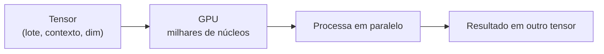

# Tensores: a matéria-prima de tudo

Um **tensor** é a generalização da ideia de "número" para múltiplas dimensões. Pense nele como uma caixa de números organizada em **eixos**. Um único número é um tensor; uma lista é um tensor; uma tabela é um tensor; uma pilha de tabelas também é um tensor.

> Em aprendizado de máquina, *absolutamente tudo* — texto, imagens, pesos de rede, gradientes — vira tensor. Dominar a ideia de **shape** (formato) e de **eixos** é o que separa quem trava em erros de dimensão de quem escreve código de rede neural com fluência.


## A hierarquia: escalar, vetor, matriz, tensor 3D

A diferença entre os tipos de tensor está no **número de eixos** (também chamado de **rank** ou ordem).

| Nome | Eixos | Exemplo | Shape | Explicação |
|------|-------|---------|-------|------------|
| Escalar | 0 | $5$ | `()` | um único número |
| Vetor | 1 | $[1, 2, 3]$ | `(3,)` | uma lista de 3 números |
| Matriz | 2 | $\begin{bmatrix}1&2\\3&4\end{bmatrix}$ | `(2, 2)` | uma tabela com 2 linhas e 2 colunas |
| Tensor 3D | 3 | pilha de matrizes | `(2, 3, 4)` | 2 matrizes, cada uma $3 \times 4$ |

Não há nada de especial em parar em três eixos: redes neurais usam tensores de 4 eixos ou mais. O raciocínio é sempre o mesmo — cada número no shape corresponde a um eixo.

### De escalar até matriz, passo a passo

Um **escalar** é um único número, sem eixo:

$$
x = 3.14
$$

Um **vetor** é uma sequência de números ao longo de **um** eixo. Pense no eixo como a "direção" ao longo da qual os números se alinham:

$$
v = [1.0,\; -2.5,\; 0.0,\; 3.0]
$$

Esse vetor tem 4 elementos; seu shape é `(4,)`. A vírgula vazia depois do 4 indica que há apenas **um** eixo.

Uma **matriz** tem **dois** eixos: linhas e colunas. A convenção em aprendizado de máquina é quase sempre **`(linhas, colunas)`**:

$$
M = \begin{bmatrix}
1 & 2 & 3 \\
4 & 5 & 6
\end{bmatrix}
$$

Essa matriz tem 2 linhas e 3 colunas, logo shape `(2, 3)`. Repare que o **primeiro** número do shape é sempre a contagem do **primeiro** eixo (as linhas, aqui).

Um **tensor 3D** acrescenta um terceiro eixo. Você pode imaginá-lo como uma pilha de matrizes:

$$
T = \text{uma pilha de 2 matrizes, cada uma } 2 \times 3
$$

O shape é `(2, 2, 3)`: lê-se "2 matrizes, cada uma com 2 linhas e 3 colunas".

## A forma (shape) é tudo

Em aprendizado de máquina, a maioria esmagadora dos bugs é de **shape incompatível**. Cada operação exige que certas dimensões coincidam. Saber ler um shape é saber prever o que uma operação vai produzir.

```python
import torch

x = torch.tensor([[1, 2, 3], [4, 5, 6]])   # shape (2, 3)
print(x.shape)   # torch.Size([2, 3])

w = torch.tensor([[0.5], [0.5], [0.5]])    # shape (3, 1)
y = x @ w                                  # produto matricial (2,3) x (3,1)
print(y)          # tensor([[3.0], [7.5]])
print(y.shape)    # torch.Size([2, 1])
```

Vamos conferir a conta célula por célula. A matriz $x$ é:

$$
x = \begin{bmatrix} 1 & 2 & 3 \\ 4 & 5 & 6 \end{bmatrix}, \quad
w = \begin{bmatrix} 0.5 \\ 0.5 \\ 0.5 \end{bmatrix}
$$

O produto $y = x\,w$ tem shape $(2,1)$:

$$
y = \begin{bmatrix}
1 \cdot 0.5 + 2 \cdot 0.5 + 3 \cdot 0.5 \\
4 \cdot 0.5 + 5 \cdot 0.5 + 6 \cdot 0.5
\end{bmatrix}
= \begin{bmatrix} 0.5 + 1.0 + 1.5 \\ 2.0 + 2.5 + 3.0 \end{bmatrix}
= \begin{bmatrix} 3.0 \\ 7.5 \end{bmatrix}
$$

O shape `(2, 3)` multiplicado por `(3, 1)` deu `(2, 1)`: a dimensão do meio (o `3`) "desapareceu". Essa regra — as dimensões internas precisam casar — é a mesma que rege todas as camadas da rede.

## Eixos e como lê-los

Cada posição do shape é um **eixo**, e cada eixo tem um significado que **nós** atribuímos. O tensor em si não sabe o que representa; somos nós que decidimos que, por exemplo, o eixo 0 é o "lote" e o eixo 1 é o "contexto".

Para um tensor com shape `(2, 3)`:

- Eixo 0 tem tamanho 2 (as linhas).
- Eixo 1 tem tamanho 3 (as colunas).

Contagem de elementos: basta multiplicar os tamanhos dos eixos. Um tensor de shape `(2, 3)` tem $2 \times 3 = 6$ elementos. Um de shape `(2, 3, 4)` tem $2 \times 3 \times 4 = 24$ elementos. Isso é útil para estimar uso de memória: cada elemento ocupa um número fixo de bytes, então o total cresce com o **produto** das dimensões.

## Indexação: como pegar pedaços do tensor

Indexar um tensor é "recortar" um pedaço escolhendo posições nos eixos. Comece simples:

```python
x = torch.tensor([[1, 2, 3], [4, 5, 6]])   # shape (2, 3)

x[0]      # tensor([1, 2, 3])   → linha 0
x[1]      # tensor([4, 5, 6])   → linha 1
x[0, 2]   # tensor(3)          → linha 0, coluna 2
x[:, 0]   # tensor([1, 4])     → coluna 0, todas as linhas
```

O símbolo `:` significa "todos os elementos desse eixo". Quando escrevemos `x[:, 0]`, estamos dizendo: "para **todas** as linhas, pegue a **coluna 0**".

### Exemplo com tensor 3D e indexação

```python
t = torch.tensor([
    [[1, 2], [3, 4]],   # matriz 0
    [[5, 6], [7, 8]],   # matriz 1
])                      # shape (2, 2, 2)

t[0]       # tensor([[1, 2], [3, 4]])  → matriz 0
t[1]       # tensor([[5, 6], [7, 8]])  → matriz 1
t[0, 1]    # tensor([3, 4])            → matriz 0, linha 1
t[0, 1, 1] # tensor(4)                 → matriz 0, linha 1, coluna 1
t[:, 0, 1] # tensor([2, 6])            → coluna 1 da linha 0 de TODAS as matrizes
```

Cada índice "resolve" um eixo, da esquerda para a direita. O primeiro índice seleciona no eixo 0, o segundo no eixo 1, e assim por diante. É por isso que a ordem do shape importa tanto.

## Por que GPUs

Uma rede neural executa, a cada passo, milhares de multiplicações e somas. O que faz a diferença é que essas operações são **independentes** entre si: dá para calcular todas ao mesmo tempo.

- Uma **CPU** tem poucos núcleos, muito rápidos e versáteis.
- Uma **GPU** tem milhares de núcleos simples, especializados em fazer a mesma operação sobre muitos números de uma vez.

Multiplicação de matrizes é o exemplo perfeito de operação **massivamente paralela**: cada elemento do resultado é um produto escalar independente. Por isso os tensores são o formato ideal — eles agrupam os números de modo que a GPU consiga processá-los em blocos gigantes.



A mensagem prática: **agrupe o trabalho em tensores e deixe a GPU fazer o paralelismo**. Quanto maior o lote, melhor se aproveita o hardware.

## Autograd: cada tensor lembra sua história

O segundo superpoder dos tensores (além do paralelismo) é o **autograd**. Quando criamos um tensor com `requires_grad=True`, o sistema registra **cada operação** feita sobre ele em um grafo. Depois, chamando `.backward()`, ele percorre esse grafo de trás para frente e calcula as **derivadas** de tudo automaticamente.

```python
import torch

x = torch.tensor([2.0], requires_grad=True)
w = torch.tensor([3.0], requires_grad=True)

y = x * w                 # 2 * 3 = 6
L = y * y                 # L = 36
L.backward()              # calcula dL/dx e dL/dw

print(x.grad)             # tensor([12.0])   dL/dx = 2 * w * y = 2 * 3 * 2 = 12
print(w.grad)             # tensor([12.0])   dL/dw = 2 * x * y = 2 * 2 * 3 = 12
```

Vamos conferir a derivada na mão. Temos $L = (x \cdot w)^2$. Pela regra da cadeia:

$$
\frac{\partial L}{\partial x} = 2(xw)\cdot w = 2 \cdot 6 \cdot 3 = 36
$$

Espera — o resultado da mão deu 36, mas o código imprime 12. O que houve? Vamos refazer com cuidado. Na verdade $L = y^2$ com $y = xw$, então:

$$
\frac{\partial L}{\partial x} = \frac{\partial L}{\partial y}\cdot\frac{\partial y}{\partial x} = 2y \cdot w = 2 \cdot (2 \cdot 3) \cdot 3 = 2 \cdot 6 \cdot 3 = 36
$$

Hmm, a derivada correta é 36, não 12. Este é um ponto ótimo para destacar um erro sutil: a derivada de $y^2$ em relação a $y$ é $2y$, e $y = 6$, dando $12$; mas isso ainda precisa ser multiplicado por $\partial y / \partial x = w = 3$, resultando em $36$. O número 12 que apareceu acima é, na verdade, apenas a derivada parcial $\partial L / \partial y$. Para o gradiente de $x$, o valor completo é $36$.

> Detalhe importante: o gradiente que chega a um tensor **já é o produto de toda a cadeia** de derivadas até ele. Erros de "faltou multiplicar por algo" aparecem exatamente quando se confunde a derivada local com o gradiente acumulado.

O essencial a reter: **todo tensor tem um gradiente irmão, de mesmo shape**. Se um peso tem shape `(3, 1)`, seu gradiente também tem shape `(3, 1)`. Isso é o que permite o treinamento: o otimizador percorre os tensores e seus gradientes, subtraindo um do outro.

## Exemplo numérico completo

Vamos montar um mini-lote com 2 textos de 4 tokens e acompanhar os shapes:

```python
import torch

# 2 textos, 4 tokens cada → shape (2, 4)
ids = torch.tensor([
    [322, 15432, 8911, 30],
    [899, 21, 3412, 30],
])

# tabela de embeddings: vocab=50000, dim=8 (mini por simplicidade)
vocab, dim = 50000, 8
embedding = torch.nn.Embedding(vocab, dim)

x = embedding(ids)
print(x.shape)   # torch.Size([2, 4, 8])
```

Agora `x` tem shape `(2, 4, 8)`: 2 textos, 4 posições, 8 números por posição. Uma camada linear com `dim` entradas e `dim` saídas opera sobre o **último** eixo:

```python
lin = torch.nn.Linear(dim, dim)   # matriz de pesos (8, 8)
y = lin(x)
print(y.shape)   # torch.Size([2, 4, 8])  → o shape não muda
```

A camada linear aplica, para cada par `(lote, contexto)`, a mesma multiplicação de matriz sobre o vetor de 8 números. O shape se mantém `(2, 4, 8)` — só os valores mudam. Essa propriedade de "preservar o shape, transformando apenas o último eixo" é o que permite empilhar dezenas de camadas sem confusão.

## Tensores, BitLinear e pesos ternários


O **BitLinear** (do BitNet) guarda os pesos ternários como inteiros e uma **escala** $\alpha$ à parte:

$$
\tilde{w} = \text{clip}\!\left(\text{round}\!\left(\frac{w}{\alpha}\right), -1, 1\right), \quad
\alpha = \frac{1}{nm}\sum_{ij}|w_{ij}|
$$

Como multiplicar por $+1$, $-1$ ou $0$ não exige multiplicador de ponto flutuante, a multiplicação de matrizes vira soma e negação — muito mais baratas. Ainda assim, todos os tensores continuam com os mesmos shapes de um modelo denso: é a magia da representação ternária.

## Erros comuns com tensores

- **Confundir a ordem do shape.** `(lote, contexto)` é diferente de `(contexto, lote)`; inverter os eixos produz contas erradas ou estouro de memória.
- **Ignorar a dimensão do meio.** Em um produto de matrizes, as dimensões internas precisam casar: `(m, n) @ (n, p)`.
- **Esperar que o gradiente tenha outro shape.** O gradiente tem sempre o **mesmo shape** do tensor original.
- **Esquecer o eixo do lote.** Muitas operações em PyTorch assumem que o eixo 0 é o lote; ao processar um único exemplo, é preciso adicionar uma dimensão `(1, contexto)`.
- **Não usar a GPU quando deveria.** Deixar o tensor na CPU enquanto a GPU espera gera gargalos; mover com `.to(device)` resolve.

## Resumo

- Tensor = número organizado em **eixos**; o **rank** é o número de eixos.
- Escalar `()`, vetor `(n,)`, matriz `(n, m)`, tensor 3D `(n, m, k)`.
- O **shape** diz o tamanho de cada eixo; o total de elementos é o **produto** das dimensões.
- **Indexação** resolve os eixos da esquerda para a direita; `:` seleciona tudo.
- **GPUs** exploram o paralelismo da multiplicação de matrizes.
- **Autograd** registra as operações e calcula gradientes automaticamente; gradiente tem o mesmo shape do tensor.
- Pesos **ternários** do BitLinear mantêm os mesmos shapes, mas trocam multiplicações caras por somas e negações.
