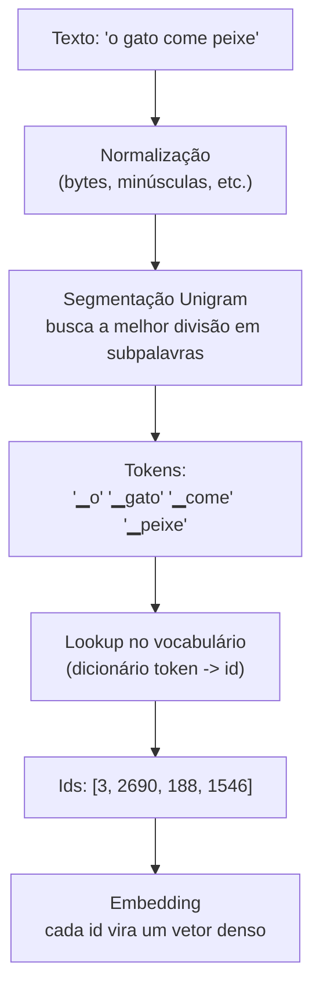
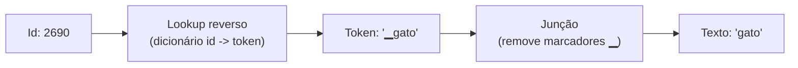

# Tokenizer e vocabulário


## Intuição: o problema do vocabulário infinito

Toda língua é um conjunto aberto. Palavras novas surgem o tempo todo: nomes próprios, gírias, termos técnicos, erros de digitação, números, URLs. Um vocabulário que guardasse uma entrada para cada palavra possível seria infinito — e, na prática, esmagadoramente grande e cheio de entradas raríssimas.

A pergunta central da tokenização é: **como representar um espaço infinito de texto com uma tabela finita de tamanho razoável?**

Existem três respostas clássicas, em ordem crescente de sofisticação:

1. **Por caractere** — vocabulário minúsculo (algumas centenas de entradas), mas sequências gigantes: cada palavra de 8 letras vira 8 tokens. O modelo precisa "aprender" a soletrar.
2. **Por palavra** — sequências curtas, mas vocabulário colossal e incapaz de lidar com o desconhecido.
3. **Por subpalavra** — o equilíbrio: um vocabulário de dezenas de milhares de pedaços que, combinados, montam qualquer palavra. Palavras frequentes viram um token só; palavras raras viram várias subpalavras.


## Conceito: subpalavras

Uma **subpalavra** é um pedaço recorrente de texto, menor que uma palavra mas maior que uma letra. Veja como uma palavra pode ser decomposta:

| Palavra | Decomposição em subpalavras |
|---|---|
| `gato` | `gato` (uma só) |
| `gatos` | `gato` + `s` |
| `impossível` | `im` + `possível` |
| `reimpossível` | `re` + `im` + `possível` |

A intuição é linguística: prefixos (`re`, `im`), sufixos (`s`, `mente`) e radicais (`possível`) se repetem por toda a língua. Se o vocabulário contém essas peças, ele consegue montar uma quantidade enorme de palavras — inclusive algumas que nunca viu, como `reimpossível`.

Para que a decomposição seja inequívoca, os tokenizers costumam marcar o início de palavra. No `t5-small` (e na família SentencePiece), o caractere `▁` (U+2581, "lower one eighth block") é prefixado ao token que inicia uma palavra:

| Texto | Tokens |
|---|---|
| `o gato` | `▁o`, `▁gato` |
| `gatos` | `▁gato`, `s` |

Perceba: o `s` de `gatos` **não** tem o `▁`, porque não começa uma palavra. Essa marcação permite reconstruir os espaços no `decode` — sem ela, seria impossível saber onde uma palavra termina.

## Como um vocabulário de subpalavras é construído

### A família BPE/WordPiece

Os dois algoritmos mais conhecidos para construir vocabulários de subpalavras são o **BPE** (Byte-Pair Encoding) e o **WordPiece**. Apesar dos detalhes diferentes, ambos seguem a mesma intuição: começar de um vocabulário de caracteres e, iterativamente, **fundir os pares mais frequentes** até atingir o tamanho desejado.

O pseudoalgoritmo do BPE:

```text
1. Inicialize o vocabulário com todos os caracteres presentes no corpus.
2. Repita até atingir o tamanho desejado:
   a. Conte a frequência de cada PAR de símbolos adjacentes no corpus.
   b. Encontre o par mais frequente (ex: "t" + "e" -> "te").
   c. Adicione "te" ao vocabulário.
   d. Substitua todas as ocorrências de "t" seguido de "e" por "te".
3. Resultado: um vocabulário de subpalavras comuns.
```

O WordPiece difere no critério de escolha do par a fundir: em vez da frequência pura, ele maximiza o **ganho de verossimilhança** — prefere a fusão que mais aumenta a probabilidade do corpus sob um modelo de linguagem simples:

$$
\text{score}(a, b) = \frac{\text{freq}(ab)}{\text{freq}(a) \cdot \text{freq}(b)}
$$

onde $\text{freq}(ab)$ é quantas vezes o par aparece junto e $\text{freq}(a)$, $\text{freq}(b)$ as frequências individuais. Um score alto significa que $a$ e $b$ aparecem juntos com muito mais frequência do que o acaso explicaria — logo, são um bom candidato a virar um único token.

### O que o `t5-small` usa de fato

É importante ser preciso aqui: o `t5-small` **não** usa BPE nem WordPiece clássicos. Ele usa o **SentencePiece** com um modelo **Unigram**, um parente próximo da mesma família. O SentencePiece trata o texto como uma sequência de bytes (não de caracteres), o que o torna independente de codificação e robusto a qualquer símbolo — emojis, acentos, kanji, tudo vira bytes que depois são agrupados.

O modelo Unigram funciona "de trás para frente" em relação ao BPE: em vez de fundir pares, ele começa com um vocabulário grande e **remove** iterativamente os tokens que menos contribuem para a probabilidade do corpus, até sobrar o número desejado. Na hora de tokenizar, ele resolve uma busca de Viterbi para escolher a segmentação de maior probabilidade.

A consequência prática para você: a intuição BPE/WordPiece (fundir/remover pedaços frequentes) continua válida, mas o detalhe do algoritmo é o Unigram. O que importa para o uso é o resultado — um vocabulário de subpalavras que segmenta bem o texto.

## Os ids especiais em detalhe

### `<pad>` — o preenchimento


```python
pad_token_id = tokenizer.pad_token_id   # 0
criterion = nn.CrossEntropyLoss(ignore_index=pad_token_id)
```

### `</s>` — o fim de sequência


### `<unk>` — o desconhecido

O `<unk>` (id 2) é o destino de qualquer símbolo que o tokenizer não consegue mapear. No SentencePiece baseado em bytes, ele é **raríssimo**: como todos os bytes têm representação, praticamente qualquer entrada é segmentável, e o `<unk>` só aparece em casos extremos.

### Os sentinels `<extra_id_N>`


## Encode e decode: o par fundamental

O `encode` converte texto em ids; o `decode` faz o caminho inverso. Eles não são perfeitamente simétricos, como vemos com um exemplo concreto.

```python
from transformers import AutoTokenizer
tok = AutoTokenizer.from_pretrained("t5-small")

texto = "O gato come peixe."
ids = tok.encode(texto, add_special_tokens=False)
print(ids)                     # ex: [55, 4, 2690, 188, 1546, 5]
print(tok.decode(ids))         # "O gato come peixe."

tokens = tok.tokenize(texto)
print(tokens)                  # ['▁O', '▁gato', '▁come', '▁peixe', '.']
```

Note os marcadores `▁` marcando início de palavra e a pontuação `.` como token isolado. A pontuação vira token próprio porque é frequente e semanticamente relevante.

## Diagrama: do texto ao id, passo a passo



O caminho inverso converte IDs previstos em texto:



## Limitações e armadilhas

### A divisão nem sempre é "inteligente"

A segmentação é estatística, não semântica. O tokenizer não "entende" que `im` + `possível` tem sentido, apenas que essa divisão é a mais provável segundo as contagens do corpus de origem. Consequências:

- Palavras compostas podem ser quebradas de forma pouco intuitiva.
- A mesma palavra pode ser dividida de formas diferentes em contextos raros.
- Erros de digitação produzem segmentações inesperadas.

### O viés do corpus de origem

O vocabulário do `t5-small` foi treinado sobre um corpus específico (majoritariamente inglês e multilíngue do C4). Textos de domínios muito diferentes do original — jargão médico, código de programação, idiomas com escrita própria — podem ser segmentados de forma ineficiente (muitos tokens por palavra) ou gerar tokens pouco frequentes.

### O custo em tokens

Uma palavra que não está no vocabulário como unidade é dividida em várias subpalavras, consumindo mais tokens — e, portanto, mais da janela de contexto. Um texto técnico denso pode "gastar" `context_window` mais rápido que um texto comum.

### A dependência total do modelo

O modelo só produz ids que existem no vocabulário. Ele nunca vai "inventar" um token novo: toda a sua saída é uma distribuição sobre os 32.128 ids fixos. Isso significa que a cobertura do tokenizer é um teto rígido para o que o modelo consegue expressar.

## Exemplo numérico progressivo

Vamos ver como a escolha do vocabulário afeta a representação de três frases, comparando as três estratégias.

### Por caractere

Vocabulário de ~150 caracteres. A frase `"o gato come peixe"` (17 caracteres) vira 17 tokens:

```
o   _ g a t o   _ c o m e   _ p e i x e   ->   17 tokens
```

Sequência longa, vocabulário minúsculo. O modelo precisa aprender a juntar letras.

### Por palavra

Vocabulário hipotético com todas as palavras do corpus. A frase vira 4 tokens:

```
o   gato   come   peixe   ->   4 tokens
```

Sequência curta, mas o vocabulário explode (e `"peixe"` raro ou erros de digitação viram `<unk>`).

## Erros comuns

- **Confundir o tamanho do vocabulário com o tamanho do corpus**: `vocab_size` é o número de subpalavras distintas, não o número de palavras do dataset.
- **Tratar `tokenize` e `encode` como sinônimos**: um devolve strings, o outro devolve inteiros.
- **Esquecer os marcadores `▁`**: apagá-los na mão quebra a reconstrução dos espaços no `decode`.
- **Assumir que `<unk>` é frequente**: no SentencePiece baseado em bytes, ele é raro; se aparecer muito, algo está errado na entrada.
- **Esperar segmentação "semântica"**: o tokenizer não entende significado; ele só segue estatísticas do corpus de origem.
- **Ignorar o custo de tokens raros**: textos de domínio distante podem estourar a janela de contexto mais rápido que o esperado.
- **Não alinhar o `vocab_size` do modelo com o do tokenizer**: instanciar o modelo com um tamanho de vocabulário diferente do tokenizer produz shapes incompatíveis na cabeça de saída.

## Resumo

- O tokenizer converte texto em inteiros; o vocabulário é a tabela que dá um id a cada subpalavra.
- Subpalavras equilibram cobertura e tamanho de sequência, cobrindo o espaço infinito do texto com uma tabela finita.
- BPE e WordPiece constroem vocabulários fundindo pares frequentes; o `t5-small` usa SentencePiece/Unigram, da mesma família.
- `encode` converte texto em IDs; `decode` faz o inverso, usando o vocabulário correspondente.
- O marcador `▁` marca início de palavra e permite reconstruir os espaços.
- O tamanho do vocabulário define o custo do embedding, da cabeça de saída e do softmax, e o `context_window` é medido em tokens.
- Limitações: segmentação estatística, viés do corpus de origem e dependência total do modelo em relação aos 32.128 ids fixos.
