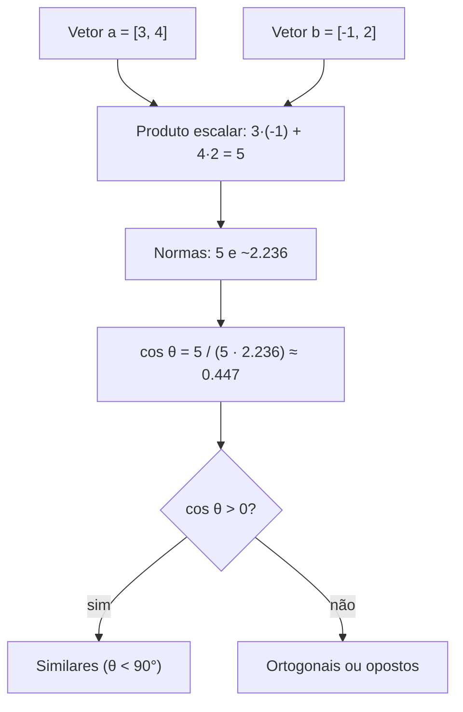

# Vetores e o produto escalar


## 1. Intuição: o que é um vetor

Pense em um vetor como uma **seta no espaço** ou como uma **linha de uma planilha**. As duas imagens são válidas e úteis:

- **Visão geométrica**: uma seta com *direção* e *comprimento* (magnitude).
- **Visão de dados**: uma lista ordenada de números, como `[2.0, -1.0, 3.5]`.

Em aprendizado de máquina a visão de dados domina. Um vetor de 3 números pode representar a posição de um ponto no espaço 3D, mas também pode representar três características de um cliente, três temperaturas em três cidades, ou — no caso que nos interessa — **a representação numérica de uma palavra** (um *embedding*).

Um vetor $\vec{v}$ em $\mathbb{R}^n$ (espaço de $n$ dimensões) é escrito como:

$$
\vec{v} = \begin{bmatrix} v_1 \\ v_2 \\ \vdots \\ v_n \end{bmatrix}
\quad\text{ou, na horizontal,}\quad
\vec{v} = \begin{bmatrix} v_1 & v_2 & \cdots & v_n \end{bmatrix}
$$

Cada $v_i$ é um **componente** (ou coordenada). A ordem importa: $[1, 2]$ e $[2, 1]$ são vetores diferentes.

### Exemplo numérico de partida

Considere os dois vetores no plano (2D):

$$
\vec{a} = \begin{bmatrix} 3 \\ 4 \end{bmatrix}, \qquad
\vec{b} = \begin{bmatrix} -1 \\ 2 \end{bmatrix}
$$

O vetor $\vec{a}$ aponta para o ponto $(3, 4)$; $\vec{b}$ aponta para $(-1, 2)$. Ao longo deste documento usaremos esse par como base e, depois, passaremos para vetores 3D e de dimensão alta.

## 2. Soma e subtração de vetores

### 2.1 A regra

Somar dois vetores de **mesmo tamanho** é somar componente a componente:

$$
\vec{a} + \vec{b} = \begin{bmatrix} a_1 \\ a_2 \\ \vdots \\ a_n \end{bmatrix}
+ \begin{bmatrix} b_1 \\ b_2 \\ \vdots \\ b_n \end{bmatrix}
= \begin{bmatrix} a_1 + b_1 \\ a_2 + b_2 \\ \vdots \\ a_n + b_n \end{bmatrix}
$$

A subtração é idêntica, trocando o sinal:

$$
\vec{a} - \vec{b} = \begin{bmatrix} a_1 - b_1 \\ a_2 - b_2 \\ \vdots \\ a_n - b_n \end{bmatrix}
$$

### 2.2 Exemplo resolvido em 2D

Com $\vec{a} = [3, 4]^T$ e $\vec{b} = [-1, 2]^T$:

$$
\vec{a} + \vec{b} = \begin{bmatrix} 3 + (-1) \\ 4 + 2 \end{bmatrix} = \begin{bmatrix} 2 \\ 6 \end{bmatrix}
$$

$$
\vec{a} - \vec{b} = \begin{bmatrix} 3 - (-1) \\ 4 - 2 \end{bmatrix} = \begin{bmatrix} 4 \\ 2 \end{bmatrix}
$$

> Interpretação geométrica: somar $\vec{b}$ a $\vec{a}$ é "andar até a ponta de $\vec{a}$ e depois andar $\vec{b}$ a partir dali". O resultado é a diagonal do paralelogramo formado pelas duas setas (a chamada *regra do paralelogramo*).

### 2.3 Exemplo resolvido em 3D

$$
\vec{u} = \begin{bmatrix} 1.5 \\ -2.0 \\ 0.5 \end{bmatrix}, \qquad
\vec{v} = \begin{bmatrix} -0.5 \\ 3.0 \\ -1.0 \end{bmatrix}
$$

$$
\vec{u} + \vec{v} = \begin{bmatrix} 1.5 + (-0.5) \\ -2.0 + 3.0 \\ 0.5 + (-1.0) \end{bmatrix}
= \begin{bmatrix} 1.0 \\ 1.0 \\ -0.5 \end{bmatrix}
$$

$$
\vec{u} - \vec{v} = \begin{bmatrix} 1.5 - (-0.5) \\ -2.0 - 3.0 \\ 0.5 - (-1.0) \end{bmatrix}
= \begin{bmatrix} 2.0 \\ -5.0 \\ 1.5 \end{bmatrix}
$$

Repare como os números negativos e flutuantes entram na conta sem nenhuma regra nova: a aritmética é exatamente a mesma, componente a componente.

## 3. Multiplicação por escalar

Multiplicar um vetor por um número real $c$ (um **escalar**) estica ou encolhe a seta, e pode invertê-la se $c$ for negativo:

$$
c \cdot \vec{a} = c \cdot \begin{bmatrix} a_1 \\ a_2 \\ \vdots \\ a_n \end{bmatrix}
= \begin{bmatrix} c \cdot a_1 \\ c \cdot a_2 \\ \vdots \\ c \cdot a_n \end{bmatrix}
$$

### Exemplo resolvido

Com $\vec{a} = [3, 4]^T$ e $c = 2$:

$$
2 \cdot \vec{a} = \begin{bmatrix} 2 \cdot 3 \\ 2 \cdot 4 \end{bmatrix} = \begin{bmatrix} 6 \\ 8 \end{bmatrix}
$$

Com $c = -0.5$:

$$
-0.5 \cdot \vec{a} = \begin{bmatrix} -0.5 \cdot 3 \\ -0.5 \cdot 4 \end{bmatrix} = \begin{bmatrix} -1.5 \\ -2.0 \end{bmatrix}
$$

O vetor $2\vec{a}$ tem o **dobro do comprimento** de $\vec{a}$ e mesma direção. O vetor $-0.5\vec{a}$ tem **metade do comprimento** e aponta na **direção oposta**.

Essa operação é a base de duas coisas importantíssimas em redes neurais:

- O **viés (bias) e o passo do otimizador**: atualizar um peso $w \leftarrow w - \eta \cdot \nabla L$ multiplica um vetor (o gradiente) por um escalar (a taxa de aprendizado $\eta$).
- A **normalização** de um vetor: dividir um vetor pela sua própria norma (seção 5) produz um vetor de comprimento $1$.

## 4. O produto escalar (dot product)

### 4.1 Definição

O produto escalar de dois vetores de mesmo tamanho é um **número** obtido somando os produtos dos componentes correspondentes:

$$
\vec{a} \cdot \vec{b} = a_1 b_1 + a_2 b_2 + \cdots + a_n b_n = \sum_{i=1}^{n} a_i b_i
$$

Notações equivalentes: $\vec{a} \cdot \vec{b}$, $\langle \vec{a}, \vec{b} \rangle$, ou $\vec{a}^T \vec{b}$ (transposta de um, vezes o outro — como multiplicação de matrizes).

### 4.2 Exemplo resolvido em 2D

$$
\vec{a} = \begin{bmatrix} 3 \\ 4 \end{bmatrix}, \qquad
\vec{b} = \begin{bmatrix} -1 \\ 2 \end{bmatrix}
$$

$$
\vec{a} \cdot \vec{b} = (3)(-1) + (4)(2) = -3 + 8 = 5
$$

O resultado é o escalar $5$.

### 4.3 Exemplo resolvido em 3D (com negativos e flutuantes)

$$
\vec{u} = \begin{bmatrix} 1.5 \\ -2.0 \\ 0.5 \end{bmatrix}, \qquad
\vec{v} = \begin{bmatrix} -0.5 \\ 3.0 \\ -1.0 \end{bmatrix}
$$

$$
\vec{u} \cdot \vec{v} = (1.5)(-0.5) + (-2.0)(3.0) + (0.5)(-1.0)
$$

$$
= -0.75 + (-6.0) + (-0.5) = -7.25
$$

Resultado: $-7.25$. Note que o produto escalar **pode ser negativo** — isso é informação valiosa, como veremos a seguir.

### 4.4 Exemplo em dimensão alta (o caso real)

Em um modelo de linguagem, embeddings têm centenas ou milhares de dimensões. O mecanismo é idêntico, só que a soma é mais longa. Com dois embeddings de 4 dimensões:

$$
\vec{e}_1 = \begin{bmatrix} 0.2 \\ -0.5 \\ 1.0 \\ 0.8 \end{bmatrix}, \qquad
\vec{e}_2 = \begin{bmatrix} 0.6 \\ 0.1 \\ -0.3 \\ 0.4 \end{bmatrix}
$$

$$
\vec{e}_1 \cdot \vec{e}_2 = (0.2)(0.6) + (-0.5)(0.1) + (1.0)(-0.3) + (0.8)(0.4)
$$

$$
= 0.12 + (-0.05) + (-0.3) + 0.32 = 0.09
$$

O valor $0.09$ resume, em um único número, o quanto esses dois vetores "apontam na mesma direção".

## 5. Norma (magnitude) de um vetor

A **norma** (ou magnitude, ou comprimento) de um vetor é quanto ele "mede". No plano, pelo teorema de Pitágoras:

$$
\lVert \vec{a} \rVert = \sqrt{a_1^2 + a_2^2 + \cdots + a_n^2} = \sqrt{\sum_{i=1}^{n} a_i^2}
$$

Observe que isso é o produto escalar do vetor **consigo mesmo**, dentro de uma raiz:

$$
\lVert \vec{a} \rVert = \sqrt{\vec{a} \cdot \vec{a}}
$$

### Exemplo resolvido

Para $\vec{a} = [3, 4]^T$:

$$
\lVert \vec{a} \rVert = \sqrt{3^2 + 4^2} = \sqrt{9 + 16} = \sqrt{25} = 5
$$

Para $\vec{v} = [-1, 2]^T$:

$$
\lVert \vec{v} \rVert = \sqrt{(-1)^2 + 2^2} = \sqrt{1 + 4} = \sqrt{5} \approx 2.236
$$

Em 3D, para $\vec{u} = [1.5, -2.0, 0.5]^T$:

$$
\lVert \vec{u} \rVert = \sqrt{1.5^2 + (-2.0)^2 + 0.5^2} = \sqrt{2.25 + 4.0 + 0.25} = \sqrt{6.5} \approx 2.550
$$

> Repare que a norma **nunca é negativa**, mesmo que os componentes sejam negativos, porque cada um é elevado ao quadrado.

### O vetor unitário (versor)

Um vetor de norma $1$ é chamado de **unitário** (ou versor). Normalizar um vetor é dividi-lo por sua norma:

$$
\hat{a} = \frac{\vec{a}}{\lVert \vec{a} \rVert}
$$

Para $\vec{a} = [3, 4]^T$:

$$
\hat{a} = \frac{1}{5} \begin{bmatrix} 3 \\ 4 \end{bmatrix} = \begin{bmatrix} 0.6 \\ 0.8 \end{bmatrix}
$$

Confirmando: $\lVert \hat{a} \rVert = \sqrt{0.6^2 + 0.8^2} = \sqrt{0.36 + 0.64} = \sqrt{1} = 1$.

Em redes neurais, a normalização aparece em cada bloco: o **RMSNorm** (usado no RetNet e em quase todo transformer moderno) divide ativações pela sua norma, mantendo os valores em escala controlada e estável durante o treinamento.

## 6. Significado geométrico: similaridade e ângulo

Aqui está o motivo de o produto escalar ser a operação mais importante para modelos de linguagem. Ele mede o quanto dois vetores **apontam na mesma direção**, ou seja, o quanto são **similares**.

### 6.1 A fórmula do ângulo

O produto escalar se relaciona com o **cosseno do ângulo** $\theta$ entre os dois vetores:

$$
\vec{a} \cdot \vec{b} = \lVert \vec{a} \rVert \, \lVert \vec{b} \rVert \, \cos\theta
$$

Isolando o cosseno:

$$
\cos\theta = \frac{\vec{a} \cdot \vec{b}}{\lVert \vec{a} \rVert \, \lVert \vec{b} \rVert}
$$

Isso é exatamente a **similaridade de cosseno**, a métrica de similaridade mais usada para comparar embeddings.

### 6.2 Interpretando o sinal e o valor

| Valor de $\vec{a} \cdot \vec{b}$ | Ângulo $\theta$ | Interpretação |
|----------------------------------|-----------------|----------------|
| $\vec{a} \cdot \vec{b} > 0$ | $\theta < 90^\circ$ | Apontam "na mesma direção" (similares) |
| $\vec{a} \cdot \vec{b} = 0$ | $\theta = 90^\circ$ | Ortogonais (independentes) |
| $\vec{a} \cdot \vec{b} < 0$ | $\theta > 90^\circ$ | Apontam em direções opostas (opostos) |

### 6.3 Exemplo numérico resolvido

Para $\vec{a} = [3, 4]^T$ e $\vec{b} = [-1, 2]^T$, já sabemos que $\vec{a} \cdot \vec{b} = 5$, $\lVert \vec{a} \rVert = 5$ e $\lVert \vec{b} \rVert = \sqrt{5} \approx 2.236$. Logo:

$$
\cos\theta = \frac{5}{5 \cdot 2.236} = \frac{5}{11.18} \approx 0.447
$$

$$
\theta = \arccos(0.447) \approx 63.4^\circ
$$

O ângulo é menor que $90^\circ$: os vetores são parcialmente similares, mas não idênticos.

### 6.4 Caso extremo: vetores idênticos

Se $\vec{b} = \vec{a} = [3, 4]^T$:

$$
\cos\theta = \frac{3 \cdot 3 + 4 \cdot 4}{5 \cdot 5} = \frac{9 + 16}{25} = \frac{25}{25} = 1
$$

$\cos\theta = 1$ significa $\theta = 0^\circ$: mesma direção, similaridade máxima.

### 6.5 Caso extremo: vetores ortogonais

Se $\vec{b} = [-4, 3]^T$ (girar $90^\circ$):

$$
\vec{a} \cdot \vec{b} = (3)(-4) + (4)(3) = -12 + 12 = 0
$$

Produto escalar zero: os vetores são **ortogonais**, sem nenhuma sobreposição de direção.

### 6.6 Caso extremo: vetores opostos

Se $\vec{b} = [-3, -4]^T$:

$$
\vec{a} \cdot \vec{b} = (3)(-3) + (4)(-4) = -9 - 16 = -25
$$

$$
\cos\theta = \frac{-25}{5 \cdot 5} = -1
$$

$\cos\theta = -1$ significa $\theta = 180^\circ$: direções opostas, similaridade mínima.

## 7. Diagrama do fluxo de similaridade



## 8. Código: NumPy e PyTorch

As duas bibliotecas fazem exatamente as mesmas operações, com sintaxe quase idêntica.

```python
import numpy as np
import torch

# NumPy
a = np.array([3.0, 4.0])
b = np.array([-1.0, 2.0])

soma = a + b                    # [2. 6.]
sub = a - b                     # [4. 2.]
escalar = 2.0 * a               # [6. 8.]
dot = np.dot(a, b)              # 5.0
norma_a = np.linalg.norm(a)     # 5.0
cos = dot / (np.linalg.norm(a) * np.linalg.norm(b))  # 0.447...

# PyTorch
at = torch.tensor([3.0, 4.0])
bt = torch.tensor([-1.0, 2.0])

soma_t = at + bt                        # tensor([2., 6.])
dot_t = torch.dot(at, bt)               # tensor(5.)
norma_t = torch.norm(at)                # tensor(5.)
cos_t = torch.nn.functional.cosine_similarity(
    at.unsqueeze(0), bt.unsqueeze(0)
)                                        # tensor([0.4472])

print("dot:", dot, "| cos:", round(cos, 3))
```

> Detalhe importante: `cosine_similarity` espera vetores com uma dimensão de lote, por isso usamos `unsqueeze(0)` para transformar `[3, 4]` em `[[3, 4]]`.

## 10. Erros comuns

- **Somar vetores de tamanhos diferentes.** `[1, 2, 3] + [1, 2]` não faz sentido: a soma exige o mesmo número de componentes. Em PyTorch isso gera um erro de *shape*.
- **Confundir produto escalar com soma componente a componente.** O produto escalar devolve um **número**; a multiplicação elemento a elemento devolve um **vetor** ($[a_1 b_1, a_2 b_2, \ldots]$).
- **Esquecer de dividir pela norma ao comparar similaridade.** Comparar produtos escalares "crus" favorece vetores grandes. Use $\cos\theta$ quando quiser comparar *direções*, não comprimentos.
- **Achar que similaridade negativa é "erro".** Produto escalar negativo apenas indica vetores que apontam em direções opostas — informação útil, não um defeito.
- **Esquecer o `unsqueeze` ao usar `cosine_similarity`.** A função espera uma dimensão de lote; sem ela, o shape fica errado.

## 11. Resumo

| Operação | Fórmula | Resultado |
|----------|---------|-----------|
| Soma | $\vec{a} + \vec{b} = [a_i + b_i]$ | Vetor |
| Subtração | $\vec{a} - \vec{b} = [a_i - b_i]$ | Vetor |
| Escalar | $c \vec{a} = [c a_i]$ | Vetor |
| Produto escalar | $\vec{a} \cdot \vec{b} = \sum a_i b_i$ | **Número** |
| Norma | $\lVert \vec{a} \rVert = \sqrt{\sum a_i^2}$ | Número |
| Cosseno | $\cos\theta = \frac{\vec{a}\cdot\vec{b}}{\lVert a \rVert \lVert b \rVert}$ | Número em $[-1, 1]$ |
